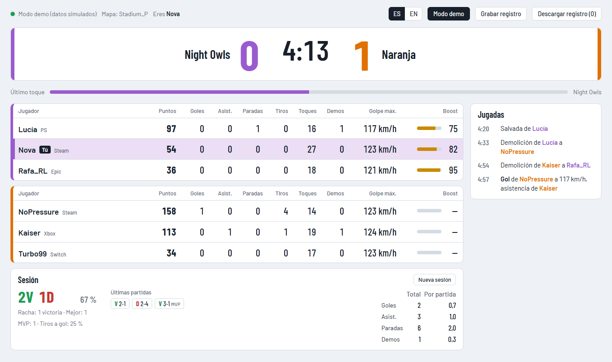

# rocket-league-scoreboard

[English](README.md) · **Español**

Marcador en directo para Rocket League, pensado para tenerlo abierto en una segunda pantalla mientras juegas. Muestra algo parecido a la tabla que sale al pulsar Tab, con algunos datos extra, y se actualiza en tiempo real.

Lee la [Stats API oficial de Rocket League](https://www.rocketleague.com/developer/stats-api), un socket local que abre el propio juego. No hay servidor ni cuenta: la página se conecta directamente al juego en tu PC.

<picture>
  <source media="(prefers-color-scheme: dark)" srcset="docs/screenshot-es-dark.png">
  
</picture>

*Captura en modo demo, con datos simulados.*

**[Prueba la demo en vivo](https://igallegodev.github.io/rocket-league-scoreboard/?demo&lang=es)**, sin necesidad del juego.

> Proyecto no oficial. No está afiliado, patrocinado ni respaldado por Psyonix ni por Epic Games. Rocket League es una marca de Psyonix LLC.

## Qué muestra

- **Marcador**: nombre y color de cada equipo (incluidos los de club), goles, reloj y prórroga, con avisos de "Repetición", "Prórroga" o "Ganador".
- **Último toque**: qué equipo tocó el balón por última vez.
- **Una tabla por equipo**, ordenada por puntos: plataforma de cada jugador (Steam, Epic, PS, Xbox, Switch), puntos, goles, asistencias, paradas, tiros, toques, demoliciones, golpe más fuerte (km/h) y boost.
- **Jugadas**: las últimas 12 (goles con velocidad y asistente, paradas, demoliciones, larguerazos, MVP y fin del partido). Las tuyas aparecen resaltadas.
- **Sesión**: victorias y derrotas de las partidas online que terminas, % de victorias, racha actual y mejor racha, los últimos 10 resultados, y tus goles, asistencias, paradas y demoliciones (en total y por partida), MVP y % de tiros que acaban en gol. Se guarda en el navegador y se reinicia sola tras 6 horas sin jugar, o con el botón **Nueva sesión**. Si sales de una partida antes de que acabe, cuenta como derrota ("aband.").
- **"Tú"**: tu fila se resalta automáticamente.
- **Español e inglés**, con el selector **ES | EN** de la barra superior.
- **Tema claro y oscuro** según el sistema, y diseño adaptable: la sesión va debajo de las tablas y las jugadas en una columna a la derecha; por debajo de 1250 px de ancho, las jugadas pasan debajo de las tablas y la sesión al final.

## Requisitos

- Rocket League en el mismo PC que el navegador.
- Un navegador actual (Chrome, Edge o Firefox).

## Activar la Stats API

La API viene desactivada. Con el juego **cerrado**, edita `TAGame\Config\TAStatsAPI.ini` en la carpeta de instalación del juego (o `DefaultStatsAPI.ini` si no existe el primero) y deja esta sección:

```ini
[TAGame.MatchStatsExporter_TA]
PacketSendRate=30
WebPort=49124
Port=0
```

- `PacketSendRate`: actualizaciones por segundo (máximo 120). `0` desactiva la API. Con 30 hay de sobra.
- `WebPort`: puerto del WebSocket al que se conecta el panel.
- `Port=0`: cierra el socket TCP (49123 por defecto) que el juego abre además del WebSocket. El panel no lo usa.

Cualquier cambio exige reiniciar el juego.

## Uso

Puedes usarlo desde la web o descargarlo. En los dos casos, abre el juego y entra en una partida: el panel se conecta solo y, si el juego no está abierto, lo reintenta cada 2 segundos.

**Desde la web**: abre [igallegodev.github.io/rocket-league-scoreboard](https://igallegodev.github.io/rocket-league-scoreboard/) en el PC donde juegas. El navegador te pedirá permiso para acceder a dispositivos de tu red local: acéptalo, porque así es como la página llega al juego. Siempre está actualizado, pero necesita conexión a Internet.

**Descargado**:

1. Descarga [rocket-league-scoreboard.zip](https://github.com/igallegodev/rocket-league-scoreboard/releases/latest/download/rocket-league-scoreboard.zip) (de la [última versión](https://github.com/igallegodev/rocket-league-scoreboard/releases/latest)) y descomprímelo.
2. Abre `index.html` con doble clic. No hace falta instalar nada ni dar permisos.

Para verlo en un stream, añade el `index.html` descargado en OBS como **fuente de navegador** con la opción de archivo local.

El historial de la sesión se guarda por separado en cada forma de abrirlo: la versión web y la descargada no lo comparten.

### Parámetros de URL

| Parámetro | Qué hace |
|---|---|
| `?demo` | Arranca en modo demo, con una partida simulada. |
| `?me=Nombre` | Fija quién eres y desactiva la detección automática. |
| `?lang=es` o `?lang=en` | Elige el idioma del panel. |
| `?port=49124` | Usa otro puerto si has cambiado `WebPort`. |

Se combinan con `&`, por ejemplo `index.html?demo&me=Kaiser`.

### Idioma

El panel arranca en español si el navegador está en español, y en inglés en cualquier otro caso. El selector **ES | EN** lo cambia al momento y la elección se recuerda. Solo se traducen los textos del panel: los nombres de equipo sin club ("Naranja") y los tipos de jugada ("Salvada", "Demolición") llegan del juego en su idioma, así que con el panel en inglés y el juego en español verás, por ejemplo, "Salvada by Kaiser".

### Modo demo

El botón **Modo demo** simula una partida 3v3 para ver el panel sin el juego abierto. Los datos tienen la misma forma que los reales. La demo usa una sesión de ejemplo propia, que no toca tu historial real.

### Grabar un registro

**Grabar registro** guarda en memoria todo lo que manda el juego y **Descargar registro** lo exporta como JSON (`rl-log-<fecha>.json`), con un campo `t` (hora local en ms) en cada mensaje. Sirve para analizar partidas o depurar el panel.

- Está apagado por defecto. Empezar una grabación nueva descarta la anterior.
- Para un máximo de 60.000 mensajes, unos 33 minutos a 30 actualizaciones por segundo.
- El equipamiento de cada jugador solo se guarda la primera vez, porque es lo que más ocupa.
- **El registro incluye los nombres y los ID de plataforma (Steam, Epic, PlayStation, Xbox) de todos los jugadores de la partida.** Ten cuidado si lo compartes.

## Qué datos da el juego

Algunos comportamientos de la API no coinciden con su documentación. Esto es lo que se ha comprobado con partidas reales, y explica lo que verás en el panel:

- **Boost**: online solo llega el de tu equipo. El de los rivales llega únicamente durante las repeticiones de gol; el resto del tiempo el panel muestra "—" (sin dato).
- **Velocidades**: llegan en km/h, aunque la documentación dice unidades del juego por segundo.
- **Sin rango ni MMR**: la API no los envía.
- **Idioma**: los nombres de equipo sin club y los textos de las jugadas llegan en el idioma del juego.
- **Quién eres**: se deduce del jugador al que sigue la cámara al empezar cada partida. Si estás espectando o la detección falla, usa `?me=`.
- **La sesión solo cuenta partidas online**: las partidas offline o contra bots no traen identificador de partida y no se guardan.

## Seguridad

La Stats API **no tiene autenticación** y, además de enviar datos, **acepta comandos** (pausar, cambiar la cámara, ocultar el HUD, controlar repeticiones).

- **No abras nunca el puerto 49124 (ni el 49123) a Internet** ni lo redirijas en el router.
- Un WebSocket no tiene las restricciones de origen de otras peticiones: mientras el juego esté abierto con la API activada, cualquier página web que tengas abierta en el navegador podría conectarse a él. Si no vas a usar el panel, desactiva la API con `PacketSendRate=0`.

## Estructura

```
index.html   estructura de la página
styles.css   estilos
app.js       conexión con el juego, estado, textos en español e inglés, render y modo demo
docs/        capturas para el README
```

Sin dependencias ni proceso de build. Las únicas peticiones externas son las fuentes Barlow y Barlow Condensed de Google Fonts, con fuentes del sistema de respaldo.

## Licencia

[MIT](LICENSE).
