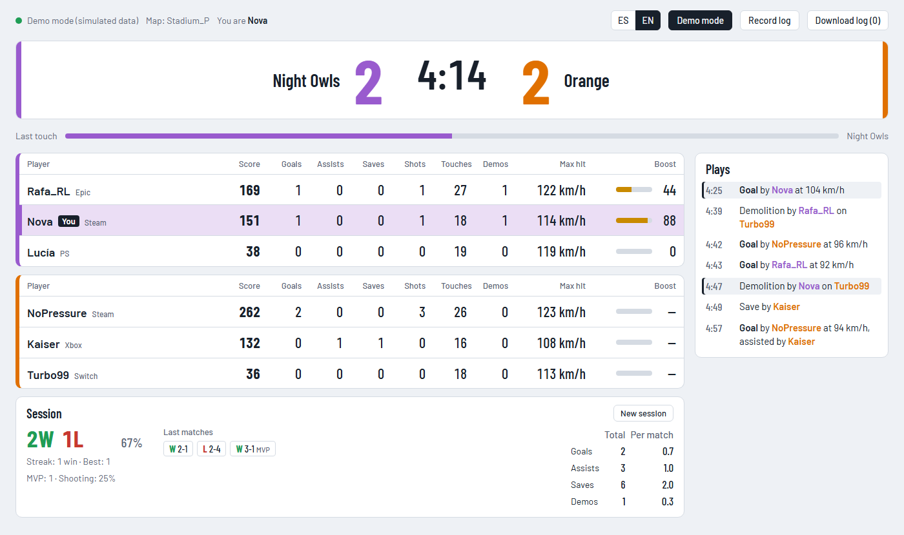

# rocket-league-scoreboard

**English** · [Español](README.es.md)

A live scoreboard for Rocket League, meant to sit on a second screen while you play. It shows something similar to the table you get when you press Tab, plus some extra data, and updates in real time.

It reads the [official Rocket League Stats API](https://www.rocketleague.com/developer/stats-api), a local socket opened by the game itself. There is no server and no account: the page connects straight to the game on your PC.

<picture>
  <source media="(prefers-color-scheme: dark)" srcset="docs/screenshot-en-dark.png">
  
</picture>

*Screenshot in demo mode, with simulated data.*

> Unofficial project. Not affiliated with, sponsored or endorsed by Psyonix or Epic Games. Rocket League is a trademark of Psyonix LLC.

## What it shows

- **Scoreboard**: each team's name and color (club ones included), goals, clock and overtime, with "Replay", "Overtime" or "Winner" notes.
- **Last touch**: which team touched the ball last.
- **One table per team**, sorted by score: each player's platform (Steam, Epic, PS, Xbox, Switch), score, goals, assists, saves, shots, touches, demolitions, hardest hit (km/h) and boost.
- **Plays**: the last 12 (goals with speed and assister, saves, demolitions, crossbar hits, MVP and end of match). Yours are highlighted.
- **Session**: wins and losses of the online matches you finish, win rate, current and best streak, the last 10 results, and your goals, assists, saves and demolitions (total and per match), MVPs and shooting percentage. It is saved in the browser and resets by itself after 6 hours without playing, or with the **New session** button. Leaving a match before it ends counts as a loss ("left").
- **"You"**: your row is highlighted automatically.
- **English and Spanish**, with the **ES | EN** switch in the top bar.
- **Light and dark theme** following your system, and a responsive layout: the session sits below the tables and the plays in a column on the right; below 1250 px wide, the plays move below the tables and the session goes last.

## Requirements

- Rocket League on the same PC as the browser.
- A current browser (Chrome, Edge or Firefox).

## Enabling the Stats API

The API is off by default. With the game **closed**, edit `TAGame\Config\TAStatsAPI.ini` in the game's install folder (or `DefaultStatsAPI.ini` if the first one doesn't exist) and leave this section:

```ini
[TAGame.MatchStatsExporter_TA]
PacketSendRate=30
WebPort=49124
Port=0
```

- `PacketSendRate`: updates per second (120 max). `0` turns the API off. 30 is plenty.
- `WebPort`: the WebSocket port the panel connects to.
- `Port=0`: closes the TCP socket (49123 by default) that the game opens besides the WebSocket. The panel doesn't use it.

Any change requires restarting the game.

## Usage

1. Download the [latest release](https://github.com/igallegodev/rocket-league-scoreboard/releases/latest) (**Source code (zip)**) and unzip it.
2. Double-click `index.html`. Nothing to install.
3. Start the game and join a match. The panel connects on its own and, if the game isn't running, retries every 2 seconds.

To show it on a stream, add `index.html` to OBS as a **browser source** using the local file option.

### URL parameters

| Parameter | What it does |
|---|---|
| `?demo` | Starts in demo mode, with a simulated match. |
| `?me=Name` | Sets who you are and turns off auto-detection. |
| `?lang=en` or `?lang=es` | Picks the panel language. |
| `?port=49124` | Uses another port if you changed `WebPort`. |

Combine them with `&`, for example `index.html?demo&me=Kaiser`.

### Language

The panel starts in Spanish if your browser is in Spanish, and in English otherwise. The **ES | EN** switch changes it instantly and your choice is remembered. Only the panel's own texts are translated: team names without a club ("Orange") and play types ("Save", "Demolition") come from the game in its own language, so with the panel in English and the game in Spanish you'll see, for example, "Salvada by Kaiser".

### Demo mode

The **Demo mode** button simulates a 3v3 match so you can see the panel without the game running. The data has the same shape as the real thing. The demo uses its own sample session and doesn't touch your real history.

### Recording a log

**Record log** keeps everything the game sends in memory, and **Download log** exports it as JSON (`rl-log-<date>.json`), with a `t` field (local time in ms) on each message. Useful to analyse matches or debug the panel.

- Off by default. Starting a new recording discards the previous one.
- Stops at 60,000 messages, about 33 minutes at 30 updates per second.
- Each player's loadout is only kept the first time, since it takes up the most space.
- **The log includes the names and platform IDs (Steam, Epic, PlayStation, Xbox) of every player in the match.** Be careful if you share it.

## What data the game provides

Some of the API's behaviour doesn't match its documentation. This is what has been checked against real matches, and it explains what you'll see in the panel:

- **Boost**: online, only your own team's boost is sent. Opponents' boost only arrives during goal replays; the rest of the time the panel shows "—" (no data).
- **Speeds**: they arrive in km/h, although the documentation says game units per second.
- **No rank or MMR**: the API doesn't send them.
- **Language**: team names without a club and play texts arrive in the game's language.
- **Who you are**: worked out from the player the camera follows at the start of each match. If you're spectating or detection fails, use `?me=`.
- **The session only counts online matches**: offline and bot matches carry no match ID and are not saved.

## Security

The Stats API has **no authentication** and, besides sending data, **accepts commands** (pause, change the camera, hide the HUD, control replays).

- **Never open port 49124 (or 49123) to the Internet** or forward it on your router.
- A WebSocket isn't bound by the origin restrictions of other requests: while the game is running with the API on, any web page open in your browser could connect to it. If you're not using the panel, turn the API off with `PacketSendRate=0`.

## Structure

```
index.html   page structure
styles.css   styles
app.js       game connection, state, English and Spanish texts, rendering and demo mode
docs/        screenshots for the README
```

No dependencies and no build step. The only external requests are the Barlow and Barlow Condensed fonts from Google Fonts, with system fallbacks.

## License

[MIT](LICENSE).
